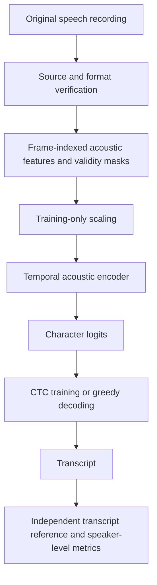

# RCLAT: Reversible Continuous Linguistic–Acoustic Transduction

**Project reference and evidence record — 21 October 2026**

RCLAT is a research programme investigating how independently known linguistic or communicative information can be recovered from continuous acoustics, how temporal organisation affects that recovery, and whether useful acoustic representations can eventually support both reconstruction and independent decoding.

The repository currently contains completed experiments using a frozen speech recogniser, a completed small-data transcription comparison, acoustic-coding controls, source and reference audits, and a locally frozen 10-hour learning-validation protocol. Execution of that original 10-hour protocol halted both arms on its numerical guard before the first epoch completed. A separately versioned corrected execution, **P10-C1**, has since passed bounded engineering checks, been locally frozen and started scientific training on both XPUs. No completed P10-C1 validation result is available at this launch snapshot. The repository does **not** yet contain a scientifically validated, independently trained RCLAT recogniser with demonstrated superiority over standard speech features. It has not demonstrated semantic reversibility.

This document describes the implementation and saved evidence. It does not amend any frozen study. Where a narrative description and a frozen machine-readable protocol differ, the protocol and its verified implementation govern execution. Status statements refer to the saved artifacts available on the date above.

## Contents

1. [Research questions and terminology](#1-research-questions-and-terminology)
2. [Current status](#2-current-status)
3. [Architecture and representations](#3-architecture-and-representations)
4. [Acoustic reversibility](#4-acoustic-reversibility)
5. [Study A: continuous-speech recovery pilot](#5-study-a-continuous-speech-recovery-pilot)
6. [Two-scale temporal-control study](#6-two-scale-temporal-control-study)
7. [Study B: small-data transcription training](#7-study-b-small-data-transcription-training)
8. [Scaling engineering and numerical preflight](#8-scaling-engineering-and-numerical-preflight)
9. [P10: frozen 10-hour learning-validation protocol](#9-p10-frozen-10-hour-learning-validation-protocol)
10. [Timing references and information accrual](#10-timing-references-and-information-accrual)
11. [Communicative-interpretation research](#11-communicative-interpretation-research)
12. [Metrics and inference](#12-metrics-and-inference)
13. [Data provenance and prior exposure](#13-data-provenance-and-prior-exposure)
14. [Relationship to MACDE and CAVEM](#14-relationship-to-macde-and-cavem)
15. [Repository map and operating commands](#15-repository-map-and-operating-commands)
16. [Evidence limits and next milestones](#16-evidence-limits-and-next-milestones)

## 1. Research questions and terminology

RCLAT separates three questions:

1. **Acoustic preservation:** Can a code reproduce the recorded waveform exactly or with measured distortion?
2. **Linguistic recovery:** Can a decoder recover a known transcript from the acoustic signal without supplied word boundaries?
3. **Communicative interpretation:** Does the acoustic signal predict independently observed listener interpretations beyond lexical content and context?

These require different targets and different evidence.

| Concept | Operational meaning | Suitable evidence |
|---|---|---|
| Continuous acoustic signal | Time-indexed sound, represented computationally by sampled, quantised audio | Original samples, sample rate and source coordinates |
| Linguistic message | A supplied symbolic reference, such as a transcript | Transcript recovery on declared evaluation data |
| Communicative function | A specified interpretation, such as perceived request versus non-request | Listener responses independent of the acoustic model |
| Acoustic reversibility | Recovery of the specified input sample representation | Sample equality, sample-rate agreement and integrity checks |
| Linguistic recovery or round trip | Recovery of the intended linguistic symbols | Transcript metrics and independent evaluation |
| Semantic or pragmatic preservation | Preservation of a task-defined interpretation | Independent listener or behavioural outcomes and appropriate controls |

For an exact acoustic codec, the requirement is:

\[
D_a(E_a(x)) = x.
\]

For transcription, the task is instead to estimate:

\[
P(Y\mid X),
\]

where \(X\) is speech audio and \(Y\) is its transcript. This is an inference task, not a unique physical inverse of speech production. Different speakers and prosodies can realise the same text with different waveforms.

For a communicative-interpretation study, a possible target is:

\[
P(S\mid X,T,C,H),
\]

where \(S\) is an independently measured interpretation, \(T\) is lexical content, \(C\) is observed context and \(H\) is the available interaction history. These variables are a research formulation; they are not all supplied by every current dataset.

**Continuous input does not imply continuous semantics.** Recovering words without externally supplied word boundaries does not establish that a model has no internal alignment or tokenisation. Successful reconstruction does not establish understanding. Successful transcript recovery does not establish recovery of prosodic intent.

## 2. Current status

| Branch | Saved status | Supported conclusion |
|---|---|---|
| Study A | Completed and closed | A frozen recogniser recovered known transcripts from continuous speech; lossless controls preserved recovery |
| Two-scale temporal controls | Completed and closed | The tested recogniser's lexical recovery depended strongly on the tested temporal arrangements |
| Study B | Completed and closed; primary superiority criterion failed | B2 did not outperform B0 under the registered small-data protocol |
| Study B training-side diagnostics | Completed, read-only | B0–B2 also produced empty transcripts on all 136 training examples |
| Scaling architecture engineering | Completed bounded checks | Both matched frontends fit four examples; larger models executed on both XPUs |
| P10 acquisition and protocol | Complete and locally frozen | Verified sources, shared cache and a prospectively specified learning policy |
| P10 scientific execution | Closed under registered numerical abstention | Both arms halted before completing epoch 1; no validation transcription scores |
| P10 numerical diagnostic | Completed, training-only | Fault localised to the installed native XPU softmax-backward path; equivalent composite-softmax candidate passed isolated no-update checks |
| Version 4 engineering validation | Completed | Both arms passed representative CPU–XPU parity checks and 200 fixed training-only updates each |
| P10-C1 corrected execution | Separately locally frozen; training started, incomplete | Both arms launched with composite softmax, stricter finite-state guards and step/batch journals; no completed validation result at launch |
| Human word-timing reference pilot | Blocked | Independent reviews are outstanding |
| Original question-versus-statement Study C | Blocked | No complete benchmark was certified among the inspected sources |
| Request-interpretation candidate | Audited; protocol remains uncertified | Listener-linked audio exists, but wording and final study requirements remain unresolved |
| Learned reversible acoustic–linguistic codec | Proposed | No demonstrated compact, independently decoded message/residual representation |
| Multilingual RCLAT recognition | Proposed | No multilingual performance result |
| MACDE–CAVEM Stage 2 | Blocked | RCLAT results do not establish downstream interaction utility |

The name “RCLAT” describes the programme's intended scope. It should not be read as a claim that the current neural transcription models are invertible.

## 3. Architecture and representations

### 3.1 Implemented transcription path



This path does not require reference word or syllable boundaries. It does require paired audio and transcripts for supervised training. It does not generate speech from text, recover speaker intentions, or decode animal meanings.

### 3.2 Native acoustic frontend

The shared feature extractor is [`acoustic_features`](../src/bioacoustic_pipeline/representation/rclat_ctc.py), which uses [`frame_observations`](../src/bioacoustic_pipeline/diagnostics/macde_data.py).

| Property | Implementation |
|---|---|
| Source format | Finite, mono, native 16 kHz audio; P10 sources are verified PCM16 FLAC |
| Window | 40 ms, or 640 samples |
| Advance | 10 ms, or 160 samples |
| Frame placement | File-local, without centred or future padding |
| Standard frontend | 64 log-mel measurements |
| Combined frontend | 64 fixed spectral-band measurements plus 12 physical measurements |
| Validity | Per-measurement masks, retained with the feature values |
| Scaling | Mask-aware statistics fitted on selected training sources only |
| Recording continuity | Each original utterance remains a separate sequence |

The 12 physical measurements are `centroid`, `spread`, `rolloff`, `rms`, `peak`, `crest`, `zcr`, `entropy`, `flatness`, `flux`, `dom_freq` and `dyn_cv`. Dominant frequency should not be relabelled as a validated fundamental-frequency estimate.

The fixed spectral grid extends above the Nyquist frequency of 16 kHz audio. Unsupported bands remain explicitly masked; 64 allocated spectral dimensions do not imply 64 supported bands for every recording.

Physical and spectral support includes the original activity and quality rules. The existing absolute RMS activity threshold is `1e-3`; sources are not peak-normalised to manufacture support. Log-mel and combined frontends therefore have different support patterns by design.

Unsupported or silent time positions are **not deleted and concatenated**. The model receives neutral fills together with masks so missing support is distinguishable from a measured zero. The timing axis remains attached to the original recording. An interrupted or separate recording is not treated as continuous history.

### 3.3 CTC alignment

Connectionist Temporal Classification sums over possible monotonic frame-to-label alignments. A blank symbol and repeated-label collapse allow a longer acoustic sequence to yield a shorter text sequence without supplied frame labels.

The current English alphabet has 29 entries: blank `-`, word separator `|`, `A`–`Z`, and apostrophe. Text normalisation uppercases and retains the implementation's letters, apostrophes and spaces. This is an English character configuration, not a multilingual vocabulary or punctuation-restoration system.

For \(N\) samples, the native frame count is:

\[
F = 1 + \left\lfloor\frac{N-640}{160}\right\rfloor.
\]

The scaling encoder applies two stride-2 convolutions, giving:

\[
F' = \left\lceil\frac{F}{4}\right\rceil.
\]

CTC requires enough output positions for the target labels and additional blanks between adjacent identical labels. Each source is checked against that requirement. A finite loss is not manufactured by enabling `zero_infinity` to hide infeasible examples.

### 3.4 Causality and offline processing

The original Study B B0–B2 models use a causal GRU-based architecture. Their poor transcription results remain part of the record.

The replacement scaling architecture is **offline and bidirectional**. Whole-utterance attention and symmetric convolution can use later audio within the supplied utterance. A causal frontend does not make the complete encoder causal.

A model run on a truncated prefix can exclude audio after the cutoff while still using bidirectional context inside that prefix. This is different from a streaming model that incrementally updates without recomputing past states. No streaming latency claim is established by the current P10 architecture.

## 4. Acoustic reversibility

The repository includes reference codecs in [`lossless_acoustic.py`](../src/bioacoustic_pipeline/representation/lossless_acoustic.py):

- **FLAC:** Mono signed PCM16 reconstruction through the standard audio format.
- **Predictive delta/zlib:** Modular first differences, zigzag encoding and compression, with a header containing rate, sample count and a PCM SHA-256 integrity value.

The technical reference is equality of the specified samples and sample rate. This does not require identical container bytes or preservation of every original file metadata field.

These codecs are acoustic controls. Neither is a learned semantic representation. Sample-exact audio should give the same deterministic recogniser output, so equal recognition performance is an expected integrity result.

A future learned representation could investigate two channels:

\[
Z=(Z_{\mathrm{message}},Z_{\mathrm{residual}}),\qquad
\hat X=D(Z_{\mathrm{message}},Z_{\mathrm{residual}}).
\]

That is a proposed experiment. The channel names would not establish disentanglement. Independent message decoding, actual coded bitrate, reconstruction checks and controls against private encoder–decoder signalling would still be required. Current CTC feature vectors cannot be assumed to reconstruct the original waveform.

## 5. Study A: continuous-speech recovery pilot

### Design

Study A evaluated 16 LibriSpeech utterances from eight speakers using a frozen `WAV2VEC2_ASR_BASE_960H` recogniser. It supplied no reference word boundaries and fitted no new decoder. Conditions included intact speech, lossless reconstruction, 500 ms block shuffling and silence, with additional prefix measurements.

### Full-utterance results

The following WER values are **pooled**, not speaker-macro values:

| Condition | Pooled WER | Exact utterances |
|---|---:|---:|
| Intact | 3.07% | 9/16 |
| Lossless | 3.07% | 9/16 |
| 500 ms block shuffle | 96.59% | 0/16 |
| Silence | 100.00% | 0/16 |

There were 64 lossless-output checks and 16 real-model future-audio exclusion checks.

### Interpretation

The pilot established reliable transcript recovery by an existing recogniser and verified the acoustic control path. Block shuffling changed order, acoustic transitions and potentially word-internal content together. It therefore did not isolate an abstract temporal-order contribution.

Prefix errors against a full transcript also count words not yet spoken. Those curves are decoder-relative descriptions, not validated word-availability times or semantic-information measurements.

Sources: [protocol](../outputs/rclat_study_a_preregistration.json), [results](../outputs/rclat_study_a_results.json), [closeout](../outputs/rclat_study_a_closeout.json).

## 6. Two-scale temporal-control study

### Design and controls

The completed study used 80 utterances from 40 speakers. The 32-speaker, 64-utterance extension was analysed separately from the eight-speaker pilot replication.

The controls compared intact and lossless audio, tapering without rearrangement, rearranged 500 ms groups, and rearranged 20 ms cells within groups. The rearranged conditions retained matched tapered-cell inventories and energy. This improved on the pilot's simple shuffle comparison.

### Prospective extension results

The following values are the extension's **speaker-macro** metrics:

| Condition | Word-inventory recall | WER |
|---|---:|---:|
| Intact | 98.06% | 2.11% |
| Lossless | 98.06% | 2.11% |
| Taper-only sham | 97.91% | 2.26% |
| Reordered 500 ms groups | 60.42% | 95.07% |
| Reordered 20 ms cells within groups | 5.31% | 100.20% |

The primary recall contrast was **55.11 percentage points**, with a speaker-bootstrap 95% interval of **[51.76, 58.38] percentage points**. Word-inventory recall uses multiset overlap: repeated words count only up to their reference multiplicity.

The saved study reports passed taper preservation and distortion-matching checks. The reported maximum waveform-RMSE mismatch between matched rearrangements was approximately 0.022%.

### Supported claim

The tested rearrangements produced strongly different lexical recoverability in the tested frozen recogniser. Preserving larger acoustic groups retained substantial word-inventory information even when ordered-transcript WER was poor. Fine-scale rearrangement largely eliminated that recoverability.

This does not identify natural 20 ms or 500 ms linguistic units. Matched cell inventories do not make the signals perceptually equivalent: transitions and dependencies change under rearrangement. Human perception, architecture-wide replication, semantic preservation and exact information-onset times remain untested.

Sources: [preregistration](../outputs/rclat_temporal_control_preregistration.json), [condition summary](../outputs/rclat_temporal_control_condition_summary.csv), [results](../outputs/rclat_temporal_control_results.json), [closeout](../outputs/rclat_temporal_control_closeout.json).

## 7. Study B: small-data transcription training

### Registered comparison

Study B used 184 utterances with speaker-disjoint partitions: 136 training utterances, 16 validation utterances and 32 evaluation utterances. The evaluation included eight speakers. Training lasted exactly 24 epochs.

| Arm | Input | Role |
|---|---|---|
| B0 | Standard log-mel features | Newly trained reference |
| B1 | Physical acoustic features | Newly trained physical representation |
| B2 | Combined physical and spectral features | Newly trained continuous representation |
| B3 | Frozen supervised-pretrained Wav2Vec2 features | Offline pretrained reference with a newly fitted downstream CTC model |

B3 had substantially different prior training access. Its performance is not a fair estimate of what the from-scratch frontends learned from 136 utterances alone.

### Held-out results

| Arm | Speaker-macro WER | Pooled WER | Empty transcripts |
|---|---:|---:|---:|
| B0 | 100.00% | 100.00% | 32/32 |
| B1 | 100.00% | 100.00% | 32/32 |
| B2 | 100.00% | 100.00% | 32/32 |
| B3 | 18.61% | 16.74% | 0/32 |

B3 recovered seven utterances exactly. The registered primary B0-minus-B2 speaker-macro WER contrast was zero, with a conditional bootstrap interval of [0, 0]. The superiority criterion failed. A shared failure does not establish representation equivalence.

### Subsequent read-only diagnosis

Saved B0–B2 predictors also produced empty transcripts on **all 136 training utterances**. Their frame-weighted mean blank probabilities were approximately 0.8641, 0.8645 and 0.8643. Gradients were finite and connected.

The failure was therefore not confined to held-out generalisation. The procedures did not establish a usable transcription mapping under the registered conditions. Blank-dominated decoding is a relevant diagnostic, but these observations do not prove one exclusive causal explanation.

The completed results and checkpoints were preserved. The replacement scaling architecture belongs to a new programme.

Sources: [preregistration](../outputs/rclat_study_b_preregistration.json), [results](../outputs/rclat_study_b_results.json), [closeout](../outputs/rclat_study_b_closeout.json), [training diagnostics](../outputs/rclat_scale_training_diagnostics.json).

## 8. Scaling engineering and numerical preflight

### Hardware and device boundary

Both Intel Arc Pro B60 XPUs completed neural execution and optimiser checks. Neural computation is on XPU; strict deterministic CTC loss uses CPU FP32 logits through a differentiable transfer:

```text
XPU features and encoder → XPU logits → CPU CTC loss
                       ← gradients through device transfer ←
```

The CPU loss does not detach the acoustic encoder. Hardware tests and numerical comparisons establish bounded implementation readiness, not transcription accuracy or exact CPU/XPU equivalence for every future input.

### Attention implementation history

| Version | Attempt | Outcome |
|---|---|---|
| v1 | Original attention execution path | Log-mel warm-up stopped on nonfinite parameter gradients; combined arm completed its bounded run |
| v2 | Finite attention padding bias | A read-only gradient probe still failed |
| v3 | Explicit Q/K/V projection, matrix multiplication and softmax with finite padding bias | Both matched arms passed the bounded learning check |

The exact underlying library or kernel cause was not established. Failed attempts and start markers were retained. v3 was the implementation selected for the original P10 attempt. The subsequently corrected P10-C1 execution uses separately versioned v4, described below.

### Learning and execution checks

With the smaller approximately 1.65M-parameter model, both frontends memorised four known training examples exactly. This demonstrates learning capability on a small positive control, not held-out transcription utility.

The larger encoder completed a separate fixed-update benchmark:

| Frontend | Parameters | Assigned XPU | Approximate peak PyTorch allocation | Audio seconds / wall second |
|---|---:|---|---:|---:|
| Log-mel | 18,647,581 | `xpu:0` | 0.80 GiB | 881 |
| Combined | 18,653,725 | `xpu:1` | 0.80 GiB | 834 |

These measurements used four known training clips of about 12 seconds each and precomputed RAM features. They exclude end-to-end waveform extraction and storage overhead. PyTorch allocated memory is not total physical-device consumption. They must not be extrapolated directly into a 100-hour training completion time.

Earlier XPU1 timing breakdowns used synchronisation without an explicit device. The saved corrected benchmarks explicitly select and synchronise the assigned device; those corrected values are the ones above.

Source: [scaling engineering closeout](../outputs/rclat_scaling_engineering_closeout.json).

### Subsequent P10 numerical diagnosis

A separate training-only diagnostic investigated the scientific execution halt. It did not restart or alter the closed P10 attempt. Fresh private model copies replayed the registered first-epoch order, bounded to one epoch and stopping at the first numerical failure.

Both arms reproduced failure at **diagnostic step 3**, after two private optimiser updates, on the same four training recordings: `8797-294123-0077`, `4853-27670-0017`, `6531-61334-0059` and `196-122150-0016`. The original scientific run did not log its exact failing step, so this localisation comes from controlled reproduction rather than an original step counter.

| Numerical comparison | Finding |
|---|---|
| Individual parameter gradients before clipping | Nonfinite values were present; aggregate-norm overflow alone is excluded |
| CPU CTC logit gradients, FP32 and FP64 | Finite for both arms |
| Full CPU backward from the isolated state | All parameter gradients finite |
| Full native XPU backward | Nonfinite parameter gradients reproduced |
| Attention forward and upstream-gradient comparison | Close agreement with CPU before softmax backward |
| Native XPU softmax score-gradient comparison | Large discrepancies from CPU |
| Dataset-free random-tensor softmax test | Discrepancy reproduced on both B60s at all eight tested last dimensions |

The synthetic tests used last dimensions 299, 320, 333, 334, 335, 336, 352 and 384. Native XPU relative L2 gradient error versus CPU ranged from approximately **0.67 to 7.27×10⁷**. These incorrect gradients could remain finite, explaining why finiteness and small-example memorisation checks alone were insufficient. CPU-autograd references were additionally checked against the analytic FP64 softmax vector–Jacobian product.

An equivalent diagnostic candidate computes probabilities as:

\[
p_i=\frac{\exp(s_i-m)}{\sum_j\exp(s_j-m)},\qquad m=\max_j s_j.
\]

It uses standard max, exponential and sum operations instead of native softmax backward. In the random-tensor tests, its maximum relative L2 gradient error versus CPU was **1.96×10⁻⁷**. Changing contiguity alone did not reliably correct the native path.

The candidate was also tested through all 12 model blocks, without optimiser updates, on both isolated failing cases:

| Arm | Nonfinite candidate parameter gradients | Relative gradient L2 error, fixed CPU upstream | Relative gradient L2 error, full CTC path |
|---|---:|---:|---:|
| Log-mel | 0 | 4.93×10⁻⁷ | 1.06×10⁻⁵ |
| Combined | 0 | 4.99×10⁻⁷ | 6.80×10⁻⁶ |

These observations localise the installed-environment failure to native XPU FP32 softmax backward. They do not identify the exact lower-level kernel or driver defect, demonstrate stability over 30 epochs, or establish transcription performance. At diagnostic closeout the candidate existed only in diagnostic model copies; frozen production modules and protocols were not changed. A subsequent separately versioned implementation is described under P10-C1. There was no validation or final-test model input, and Stage 2 remains blocked.

The diagnostic verification suite passed **34 tests**, including checks distinguishing FP32 norm overflow from nonfinite gradient elements and CPU equivalence of the candidate expression.

Sources: [diagnostic closeout](../outputs/rclat_p10_numerical/closeout.json), [bounded replay plan](../outputs/rclat_p10_numerical/plan.json), [dataset-free reproducer](../scripts/rclat_xpu_softmax_reproducer.py), [full-model candidate probe](../scripts/rclat_p10_softmax_diagnostic.py).

## 9. P10: frozen 10-hour learning-validation protocol

### Purpose and registration status

P10 asks whether both matched replacement systems can learn usable transcription beyond four-example memorisation. It is a **development learning-validation study**, not a confirmatory superiority test.

Its protocol is locally frozen and dependency-hashed. No external registration is claimed. The shared feature cache has been completed and scientific training was attempted. Both arms halted under the registered numerical-abstention rule before completing the first epoch. No validation or final-test scoring occurred.

### Acquired and audited population

| Population | Utterances | Speakers | Hours |
|---|---:|---:|---:|
| Complete `train-clean-100` inventory | 28,539 | 251 | 100.59088 |
| Selected P10 training subset | 2,814 | 251 | 9.999857 |
| Full `dev-other` validation | 2,864 | 33 | 5.121185 |

Both official archives passed their published MD5 checks, with SHA-256 receipts also recorded:

| Archive | Published MD5 |
|---|---|
| `train-clean-100.tar.gz` | `2a93770f6d5c6c964bc36631d331a522` |
| `dev-other.tar.gz` | `c8d0bcc9cca99d4f8b62fcc847357931` |

There were no CTC-length exclusions in either audited source population, no training/validation speaker overlap, and no exact decoded-audio duplicates among the selected training and validation recordings. These are exact-match checks, not a claim that every possible transformed overlap has been excluded.

Fifteen selected training recordings had prior Study B training or validation exposure. Their identifiers and prior roles are recorded in the cohort. This reuse is disclosed as development exposure.

The initial full download timed out after 600 seconds. Explicit official-mirror byte ranges completed the archive, and the assembled file passed the published full checksum. A first assembly guard falsely treated an access-time update as a content change; the guard was corrected and the rejected assembly retained. These acquisition events did not involve model fitting.

### Deterministic cohort selection

Eligible whole utterances are ranked by ascending SHA-256 of `RCLAT-P10-v1:<uid>`. An utterance is included if its samples fit within the remaining budget of **576,000,000 samples** at 16 kHz. Utterances are not cut to fill the budget. Full `dev-other` provides training-side validation.

Eligibility includes native mono 16 kHz PCM16 source verification, a usable transcript and CTC feasibility after 4× temporal subsampling. The same selected utterances and target transcripts are used for both arms.

### Frozen architecture

| Setting | Value |
|---|---|
| Implementation | `rclat_scale_v3.ScaleCTC` |
| Input dimensions | 64 log-mel, or 76 combined; validity indicators accompany both |
| Projection and temporal width | 256 |
| Conformer-style blocks | 12 |
| Attention heads | 4 |
| Feed-forward expansion | 1,024 |
| Depthwise convolution kernel | 15 |
| Temporal subsampling | Two stride-2 convolutions, 4× total |
| Normalisation | Frame-wise LayerNorm; padding masked through the encoder |
| Position representation | Sinusoidal |
| Dropout | 0 |
| Attention | Explicit FP32 matrix operations and softmax; finite padding bias |
| Inference context | Offline bidirectional whole utterance |
| Output | Character logits with greedy CTC decoding |

Both arms share common temporal-encoder and output-head initialisation. Their input projections differ because input dimensions differ. No closed-study weights are reused.

### Frozen fitting and selection policy

| Item | Rule |
|---|---|
| Seed | 0 for Python, NumPy, torch and XPU |
| Precision | FP32; no autocast or gradient scaling |
| Devices | Log-mel on `xpu:0`; combined on `xpu:1` |
| Training duration | Exactly 30 epochs; no early stopping |
| Batch size | Four whole utterances; retain final short batch |
| Batch order | Hash-ranked anew per epoch using the frozen epoch/UID rule; paired across arms |
| Optimiser | AdamW, betas `(0.9, 0.999)`, epsilon `1e-8`, weight decay `0.01` |
| Learning rate | First 500 steps warm up from `1e-6` toward `1e-3`; then cosine decay to `1e-5` at the final step |
| Gradient clipping | Global norm 5.0 |
| CTC | Differentiable CPU FP32 loss, blank 0, mean reduction, strict feasibility; no hidden invalid-loss masking |
| Validation | After every completed epoch, evaluation mode, greedy decoding, no external language model |
| Checkpoint selection | Lowest validation speaker-macro CER; ties favour the earliest epoch |
| Reporting | Selected checkpoint and final epoch, per-speaker vector, pooled metrics and nonempty fraction |
| Added objectives and processing | No auxiliary loss, denoising, augmentation, pretrained weights or reference word boundaries |

Every epoch checkpoint is saved. Any recovery must preserve the exact state and frozen dependencies. The present runner refuses to restart a previously started arm and does **not** implement automatic checkpoint resume.

### Learning gate

At its validation-selected checkpoint, **each** arm must achieve:

- Nonempty transcripts for at least **95%** of validation utterances.
- Speaker-macro CER **strictly below 50%**.

Both arms must satisfy the gate. Incomplete runs do not pass it. These thresholds establish developmental learning support under the specified validation policy; they do not establish competitive ASR or superiority of the combined representation.

Passing P10 does not automatically authorise or activate 100-hour or 960-hour training. Those stages need separate prospective evaluation specifications.

### Abstention rules

Missing or changed sources, dependency mismatches, nonfinite numerical results, CTC infeasibility, out-of-memory failures or unavailable required devices halt the affected arm. The policy prohibits silent example dropping, batch shrinking, precision switching, epoch extension, seed retries and final-test access. Failures must remain visible.

### Observed execution outcome

The shared cache completed all **5,678 recordings** in approximately **1,350.3 seconds (22.5 minutes)**. Both assigned XPUs were accessible. Each arm verified the cache, saved its runtime/start record and training-only scaler, and attempted training under the frozen policy.

| Arm | Device | Completed epochs | Observed stop condition | Validation CER / nonempty rate |
|---|---|---:|---|---|
| Log-mel | `xpu:0` | 0 | Nonfinite gradient-norm guard after backward | Unavailable |
| Combined RCLAT | `xpu:1` | 0 | Nonfinite gradient-norm guard after backward | Unavailable |

The runner raised `ValueError("Nonfinite parameter gradient")` when the return from `clip_grad_norm_` was nonfinite. The failing batch had passed the finite-logit and finite-CTC-loss checks. The saved logging does not distinguish nonfinite individual gradients from overflow or other numerical failure in the norm computation. It also does not record the exact failing step or number of earlier optimiser updates. Those quantities remain unknown.

There are no completed epoch checkpoints, epoch validation predictions or CER/WER measurements. Both processes exited with failure; neither was restarted. All feature-cache hashes were rechecked at closeout. The protocol and training implementation were not changed in response to this result.

**The joint learning gate is not passed because execution is incomplete.** This is not a measured failure against the 50% CER or 95% nonempty thresholds: neither threshold could be assessed. It establishes a numerical limitation of the registered execution path under the actual P10 batches, despite the successful bounded engineering checks. The execution closeout left the cause unresolved; the subsequent diagnostic above localised the observed fault to native XPU softmax backward, while leaving its exact lower-level implementation defect unresolved.

The original acquisition closeout is retained as a historical snapshot. The later [execution closeout](../outputs/rclat_p10/execution_closeout.json), [log-mel failure record](../outputs/rclat_p10/mel_FAILURE.json) and [combined failure record](../outputs/rclat_p10/combined_FAILURE.json) record the attempted execution. Any numerical investigation or successor fitting must be a separately documented activity; this attempt is not silently resumed or repaired.

### Frozen software snapshot

| Component | Version |
|---|---|
| Python | 3.12.11 |
| PyTorch | 2.14.1+xpu |
| torchaudio | 2.11.0+xpu |
| NumPy | 2.5.4 |
| SciPy | 1.18.1 |
| soundfile | 0.14.0 |

The runner checks these versions and frozen code dependencies. Device/runtime information is recorded when an arm starts. The acquisition closeout reports 31 passing relevant tests and clean lint; those checks are implementation evidence, not model-performance results.

Sources: [protocol](../outputs/rclat_p10/preregistration.json), [cohort and source hashes](../outputs/rclat_p10/cohort.json), [closeout](../outputs/rclat_p10/closeout.json), [archive receipt](../data/rclat_scale/archive_integrity.json).

Protocol SHA-256: `acd78df0ea76a573a5dfe0e5a4c89be2fea6ea5f4feb9da34b35ec92c23fdbe9`.

### P10-C1: separately frozen corrected execution

P10-C1 is a **new numerical execution**, not a continuation or retroactive repair of the original P10 result. The original attempt remains closed under numerical abstention and its joint learning gate remains not passed.

The versioned [`rclat_scale_v4.py`](../src/bioacoustic_pipeline/representation/rclat_scale_v4.py) preserves the v3 parameter schema, architecture and initialisation. Its sole model-computation change is replacing native attention softmax with the stable composite max/exp/sum expression. Existing v3 modules and frozen protocols remain unchanged.

The engineering plan was fixed before testing and used only training audio or synthetic tensors:

| Engineering check | Log-mel | Combined |
|---|---:|---:|
| Synthetic CPU-reference softmax cases | 12 passed | 12 passed |
| Full-model CPU–XPU parity cases | 5 passed | 5 passed |
| Fixed repeated optimiser updates | 200 completed | 200 completed |
| Maximum synthetic gradient relative L2 error | 1.94×10⁻⁷ | 1.94×10⁻⁷ |
| Maximum full-model gradient relative L2 error | 4.49×10⁻⁵ | 3.02×10⁻⁵ |
| Nonfinite gradient, parameter or optimiser-state checks | All passed | All passed |

Synthetic shapes cover batch sizes one, two and four, including the audited training CTC-length range of 38–456 frames and the previously problematic dimensions. Full-model cases include the first and previously failing batches plus metadata-selected short, median and long batch cases. Predeclared relative L2 tolerances were `1e-5` for synthetic gradients and `1e-3` for full-model gradients. Independent FP64 norm checks were performed at steps 1, 3 and every 25th step.

The 200-step checks used fresh seed-0 models and the original order, optimiser, learning-rate schedule and clipping policy. No recognition outputs, validation scores or final-test scores were produced. Engineering weights are not exported for scientific initialisation. The passing result establishes bounded numerical readiness, not full 30-epoch stability or transcription learning.

P10-C1 preserves the original scientific definition:

- The identical 2,814 training and 2,864 validation recordings, source hashes, feature cache and transcripts.
- The archived training-only scalers, without validation refitting or feature changes.
- The same two frontends, XPU assignments, fresh seed 0, architecture dimensions and parameter counts.
- The same batch order, AdamW settings, learning-rate schedule, clipping threshold and fixed 30 epochs.
- The same validation frequency, greedy decoding, speaker-macro CER selection rule and earliest-epoch tie rule.
- The same joint learning gate: each arm must have at least 95% nonempty output and speaker-macro CER strictly below 50%.
- The same development-only interpretation and prohibition on automatic 100-hour progression.

Additional execution checks inspect individual gradients before clipping and every parameter and optimiser tensor after each update. A step journal records epoch, global step, within-epoch step, source IDs and progress through forward/backward/update stages. Initial parameter hashes and a common encoder/head hash are saved. Nonfinite values trigger a recorded stop rather than gradient sanitisation, example dropping or an automatic retry.

The corrected runner reuses only verified acoustic inputs and training-only scaler statistics. It constructs new models from seed 0; it does not load original-attempt weights, diagnostic weights or engineering optimiser state. Automatic resume remains unimplemented and existing corrected start markers prohibit silent retries.

The verification suite now has **40 passing tests**, including CPU forward/backward equivalence to v3, double-precision gradient checking of the composite expression, and tests for gradient and optimiser-state guards. P10-C1 is locally frozen, not externally registered. **Corrected scientific training has started on both assigned XPUs.** The [launch record](../outputs/rclat_p10_corrected_v1/execution_launch.json) preserves the early-step observations and matching common encoder/head initialisation hashes. That snapshot does not establish full-run stability or transcription performance. The protocol-freeze and readiness artifacts retain their historical unstarted status.

Sources: [engineering plan](../outputs/rclat_p10_corrected_preflight_v1/plan.json), [engineering closeout](../outputs/rclat_p10_corrected_preflight_v1/closeout.json), [P10-C1 protocol](../outputs/rclat_p10_corrected_v1/preregistration.json).

P10-C1 protocol SHA-256: `2e8f46b6f50e497e9097331f9292aefe261a64c4e6f84d99232c64371e207e49`.

## 10. Timing references and information accrual

A central longer-term question is when acoustic evidence makes a linguistic target recoverable. Three notions must remain separate:

| Notion | Meaning |
|---|---|
| Acoustic occurrence | The relevant recorded material has happened by the cutoff |
| Decoder recoverability | A specified model can recover the target from the available input |
| Listener recoverability | Independent human listeners can recover the target under a defined listening task |

A model can predict an unspoken word from linguistic context. Correct anticipation is not proof that the target's acoustic information has already arrived.

For a frozen decoder, a possible diagnostic is a change in the true-message log score between prefixes:

\[
A(t)=\log P_\theta(Y_{\mathrm{true}}\mid X_{\leq t})
     -\log P_\theta(Y_{\mathrm{true}}\mid X_{\leq t-\Delta}).
\]

This is decoder-relative evidence accumulation. It is not automatically semantic entropy, mutual information or a human perceptual event. Full-message scores may include predictions about an unspoken suffix. Some prefixes may also be structurally too short for a complete CTC target alignment.

The repository has blinded review packets for **20 targets**, with independent reviewer and adjudication roles. The saved status records **zero completed human reviews**. Prefix-relative scoring remains blocked.

Even validated word onset/offset annotations would not by themselves identify exact linguistic-information availability. Coarticulation and contextual prediction require additional controls.

Sources: [timing protocol](../outputs/rclat_word_timing_review/protocol.json), [review status](../outputs/rclat_word_timing_review/status.json), [timing-support audit](../outputs/rclat_temporal_control_timing_support_audit.json).

## 11. Communicative-interpretation research

### Original Study C target

The preferred question-versus-statement design remains blocked. The audit did not certify a complete speaker-disjoint benchmark from the inspected sources. This is an audit outcome, not proof that no suitable dataset exists.

Production instructions alone are not sufficient interpretation references. A model must not define its own correct meanings through its acoustic predictions.

### Audited request-interpretation candidate

The Trott et al. `pros_scaled` corpus provides an adjacent pragmatic task: listeners judging whether an utterance functions as a request.

| Property | Audited material |
|---|---:|
| Listener-linked stimuli | 432 |
| Speakers | 18 |
| Sentence scripts | 12 |
| Actual critical listener choices | 8,856 |
| Listeners | 82 |
| Unique listener judgments per stimulus | 12–31 |
| Native audio | Stereo 44.1 kHz PCM16 WAV |

The audited stimuli are the **normalised WAV files used by the released experiment**, not a claim to unprocessed microphone recordings. Their source revision is pinned to commit `516442a23549710864dcf0cf7a54b88af99bb3de`.

The intended target is each recorded Request/Non-Request response, or its empirical distribution for a stimulus. Production-intent labels do not substitute for those responses. Ambiguous stimuli are not silently discarded by majority filtering.

### Draft comparison and remaining requirements

| Arm | Proposed input |
|---|---|
| C0 | Training-side verified script baseline |
| C1 | C0 plus whole-utterance acoustic summaries |
| C2 | Same lexical access and summaries plus continuous acoustic trajectories |

The draft primary endpoint is speaker-macro C1-minus-C2 binary cross-entropy in nats. It averages actual responses within stimulus, then stimuli within speaker, rather than treating more heavily rated stimuli as automatically more important. Probability clipping for evaluation is specified as `1e-6`.

Candidate evaluation uses 18 leave-one-speaker-out folds, with 14 training speakers, three validation speakers and one held-out speaker per fold. These remain **proposed**, not activated study partitions. They test new speakers with familiar scripts and the observed listener panel, not generalisation to new wording or new listeners.

All 82 listeners rated multiple speakers. The listener–speaker graph has one connected component, so speaker-disjoint folds do not make listeners independent. The final dependency-aware uncertainty procedure remains to be frozen.

The draft stereo policy selects native left channel 0 consistently, without averaging, resampling, denoising or trimming. This differs from the 16 kHz ASR frontend and does not silently inherit the MACDE 128-frame forecasting gate.

There are **432 pending independent wording reviews**. The proposal requires two independent reviewers, adjudication of disagreements, and no model-based transcript repair. Source-use terms and exact model, optimisation and uncertainty settings also remain unresolved. No interpretation models have been fitted.

A future acoustic manipulation that changes listener interpretation while preserving word recognition would be especially informative. It would still require its own prospective protocol and independent human data. Request prediction alone would not establish general semantic reversibility.

Sources: [source audit](../outputs/rclat_study_c_source_audit.json), [draft protocol](../outputs/rclat_request_protocol/protocol_draft.json), [reference readiness](../outputs/rclat_request_protocol/initial_status.json), [stereo and dependency audit](../outputs/rclat_request_protocol/stereo_and_dependency_audit.json).

## 12. Metrics and inference

### Transcript metrics

\[
\mathrm{WER}=\frac{S+D+I}{N_{\mathrm{reference\ words}}}.
\]

CER applies edit distance to normalised characters; the current reporting removes spaces for character counts. WER can exceed 100% because insertion errors are not bounded by reference length.

**Pooled** error divides summed errors by summed reference length. **Speaker-macro** error first pools errors within each speaker and then averages the speaker rates equally. Neither should be substituted for the other without labelling it.

Word-inventory recall measures reference-word multiset overlap without requiring original sequence order. It can remain substantial while ordered WER is very poor. It does not alone assess word order, grammaticality or meaning.

Nonempty output is an engineering diagnostic. It is not enough to demonstrate useful transcription, which is why P10 combines a nonempty threshold with a CER requirement.

### Dependence and uncertainty

Utterances from the same speaker and multiple judgments from the same listener are correlated. Frame counts and raw judgment counts do not equal independent participant counts.

Speaker-clustered analyses support conclusions conditional on the evaluated people and design. Small speaker samples restrict population-level claims. Repeated listener data may require crossed or hierarchical treatment rather than speaker-only resampling.

P10 selects checkpoints using validation outcomes and is explicitly developmental. A selected validation score is not an untouched test result. Future superiority claims require their own protected population, paired comparison and frozen decision rule.

## 13. Data provenance and prior exposure

The main ASR source is [LibriSpeech, OpenSLR resource 12](https://www.openslr.org/12). P10 archive and recording identities, checksums, transcripts, sample counts and decoded-audio hashes are retained locally.

| Partition or source | Exposure and permitted interpretation |
|---|---|
| `dev-clean` | Previously used in retrieval/boundary and RCLAT work; not untouched |
| `test-clean` | Partially exposed through Study B; its complete archive cannot be described as an untouched evaluation set |
| `train-clean-100` | Includes prior Mini LibriSpeech development use; selected P10 reuse is explicitly inventoried |
| `dev-other` | P10 training-side validation; no guarantee of no historical use outside inspected records |
| `test-other` | Not acquired or scored by P10; no global historical-unexposed certification |
| `train-clean-360` | A historical script names an absent external path; external execution history remains unresolved |

Prior evaluation exposure and actual model-training overlap are different facts. Acquisition alone is also different from evaluation. Each should be disclosed separately.

No automatic data expansion follows a favourable pilot. A 100-hour representation comparison and a later approximately 960-hour scaling study remain separate proposed stages. The previous 2.11% WER and 16.74% WER scores belong to pretrained-reference evaluations, not to P10 models.

## 14. Relationship to MACDE and CAVEM

| Programme | Main role | Relationship to RCLAT |
|---|---|---|
| MACDE | Continuous acoustic representation and forecasting | Supplies methodological lessons and shared feature/validity machinery |
| RCLAT | Human linguistic recovery and acoustic information experiments | Uses known transcripts and potentially independent human interpretations |
| CAVEM | Event history, context and interaction outcomes | A possible future consumer of independently validated acoustic representations |

The completed MACDE outcomes remain unchanged, including limited within-bird utility and lack of consistent cross-individual superiority. Shared code does not turn RCLAT results into new MACDE evidence.

The implemented MACDE–CAVEM interface establishes mechanical compatibility, causal post-call export and provenance handling. It does not establish incremental interaction-prediction benefit. **Stage 2 remains blocked.**

Human speech provides a positive-control setting in which linguistic references are known. It does not supply animal-language transcripts. Any animal communicative claim still requires independently grounded outcomes, reliable signal-to-event linkage and an appropriate evaluation population.

## 15. Repository map and operating commands

### Core implementation

| Path | Purpose |
|---|---|
| [`representation/rclat_ctc.py`](../src/bioacoustic_pipeline/representation/rclat_ctc.py) | Shared acoustic extraction, masks, scaling, original causal CTC model and strict loss |
| [`representation/rclat_scale_v3.py`](../src/bioacoustic_pipeline/representation/rclat_scale_v3.py) | Selected explicit-attention offline scaling encoder |
| [`representation/rclat_scale_v4.py`](../src/bioacoustic_pipeline/representation/rclat_scale_v4.py) | Separately versioned composite-softmax encoder for P10-C1 |
| [`representation/rclat_numerics.py`](../src/bioacoustic_pipeline/representation/rclat_numerics.py) | Individual-gradient, parameter and optimiser-state finite guards |
| [`representation/rclat_scale.py`](../src/bioacoustic_pipeline/representation/rclat_scale.py) | Retained original scaling architecture attempt |
| [`representation/rclat_scale_v2.py`](../src/bioacoustic_pipeline/representation/rclat_scale_v2.py) | Retained finite-mask attempt |
| [`representation/lossless_acoustic.py`](../src/bioacoustic_pipeline/representation/lossless_acoustic.py) | Exact acoustic codec controls |
| [`diagnostics/rclat.py`](../src/bioacoustic_pipeline/diagnostics/rclat.py) | Text metrics, prefix and recovery utilities |
| [`diagnostics/rclat_temporal.py`](../src/bioacoustic_pipeline/diagnostics/rclat_temporal.py) | Controlled temporal transformations |
| [`scripts/rclat_p10_protocol.py`](../scripts/rclat_p10_protocol.py) | Acquisition/cohort audit and local protocol freeze |
| [`scripts/rclat_p10_train.py`](../scripts/rclat_p10_train.py) | Separate cache and training actions under frozen dependencies |
| [`scripts/rclat_p10_closeout.py`](../scripts/rclat_p10_closeout.py) | Read-only failure closeout, or completed-run prediction replay and metric audit |
| [`scripts/rclat_p10_figures.py`](../scripts/rclat_p10_figures.py) | Descriptive figures for a completed scored run; not executed for this unscored numerical failure |
| [`scripts/rclat_p10_numerical_diagnostic.py`](../scripts/rclat_p10_numerical_diagnostic.py) | Bounded private training-order replay and CPU/XPU/CTC gradient probes |
| [`scripts/rclat_p10_attention_diagnostic.py`](../scripts/rclat_p10_attention_diagnostic.py) | Isolated attention forward and vector–Jacobian-product comparisons |
| [`scripts/rclat_p10_softmax_diagnostic.py`](../scripts/rclat_p10_softmax_diagnostic.py) | No-update full-model composite-softmax candidate checks |
| [`scripts/rclat_xpu_softmax_reproducer.py`](../scripts/rclat_xpu_softmax_reproducer.py) | Dataset-free native/composite softmax backward reproducer |
| [`scripts/rclat_p10_numerical_closeout.py`](../scripts/rclat_p10_numerical_closeout.py) | Evidence assembly and analytic CPU-reference cross-checks |
| [`scripts/rclat_p10_corrected_preflight.py`](../scripts/rclat_p10_corrected_preflight.py) | Prospectively bounded version 4 parity and 200-update engineering validation |
| [`scripts/rclat_p10_corrected_protocol.py`](../scripts/rclat_p10_corrected_protocol.py) | Separate P10-C1 protocol freeze after engineering checks |
| [`scripts/rclat_p10_corrected_train.py`](../scripts/rclat_p10_corrected_train.py) | P10-C1 verification and future scientific execution, with step journaling |
| [`scripts/rclat_transcribe.py`](../scripts/rclat_transcribe.py) | Original Study B checkpoint inference; not a P10 deployment adapter |
| [`scripts/rclat_request_protocol.py`](../scripts/rclat_request_protocol.py) | Request-study draft and reference package |
| [`scripts/rclat_word_timing_review.py`](../scripts/rclat_word_timing_review.py) | Independent timing-review package |

### Read-only P10 contract check

Run from the repository root using the existing environment:

```bash
.venv/bin/python - <<'PY'
import sys
sys.path.insert(0, "scripts")
import rclat_p10_train as p10
spec, cohort = p10.check()
print(spec["status"])
print("Training utterances:", cohort["training"]["utterances"])
print("Validation utterances:", cohort["validation"]["utterances"])
PY
```

This verifies pinned dependencies and software versions. It does not fit a model.

### Recorded P10 execution commands

The commands below describe the original attempt. Cache preparation completed; both training commands were executed and halted on the numerical guard. Existing start markers prohibit rerunning those arms automatically. These are provenance commands, not instructions to retry the closed attempt.

The shared feature cache was prepared with:

```bash
.venv/bin/python scripts/rclat_p10_train.py cache
```

The two independent arms were launched in separate device-accessible processes:

```bash
# Process 1: frozen assignment xpu:0
.venv/bin/python scripts/rclat_p10_train.py train --arm mel
```

```bash
# Process 2: frozen assignment xpu:1
.venv/bin/python scripts/rclat_p10_train.py train --arm combined
```

The runner verifies the frozen protocol and cache receipts. It writes per-epoch predictions, metrics, checkpoints, runtime/start markers and failure records. A start marker prevents silent retries. Frozen cohort and protocol builders should not be rerun to overwrite the existing research record.

The original Study B transcription CLI supports B0–B2 checkpoints. Those saved models generated empty transcripts in the completed study. B3 requires its separate frozen pretrained feature path. P10 checkpoints use a different architecture and are not interchangeable with this CLI.

### P10-C1 verification and future execution

The corrected runner's read-only verification action checks the separately frozen protocol and shared cache:

```bash
.venv/bin/python scripts/rclat_p10_corrected_train.py verify
```

The following commands are the separately versioned scientific execution entry points. They were not run during engineering validation or protocol freezing; both were subsequently invoked for the scientific launch:

```bash
.venv/bin/python scripts/rclat_p10_corrected_train.py train --arm mel
```

```bash
.venv/bin/python scripts/rclat_p10_corrected_train.py train --arm combined
```

Their artifacts and checkpoints use `outputs/rclat_p10_corrected_v1/` and `checkpoints/rclat_p10_corrected_v1/`, distinct from the closed original run. Future results must be reported as P10-C1, preserving the original numerical-abstention outcome.

### Relevant verification suite

```bash
.venv/bin/pytest -q \
  tests/test_rclat_p10_protocol.py \
  tests/test_rclat_p10_training_policy.py \
  tests/test_rclat_scale.py \
  tests/test_rclat_scale_v2.py \
  tests/test_rclat_scale_v3.py \
  tests/test_rclat_scale_gradients.py \
  tests/test_rclat_ctc.py \
  tests/test_rclat.py \
  tests/test_rclat_temporal.py
```

The recorded acquisition/protocol verification had 31 passing tests. CPU-only sandbox device enumeration is distinct from the previously completed two-XPU engineering checks.

## 16. Evidence limits and next milestones

### Claims supported by the saved studies

- A frozen recogniser recovers transcripts from continuous speech without supplied reference word boundaries.
- Exact acoustic reconstruction preserves that tested recovery.
- Tested temporal arrangements have substantially different effects on lexical recoverability.
- The registered small-data B0–B2 procedures did not learn usable transcription, including on their own training data.
- The replacement architecture can fit four examples and execute larger models on both XPUs.
- A source-audited, speaker-disjoint P10 development population and exact learning policy are locally frozen; the shared feature cache was completed and verified.
- The registered P10 execution halted both arms on a nonfinite gradient-norm check before completing the first epoch, leaving validation-learning performance unassessed.
- A separate diagnostic reproduced the halt, excluded norm overflow alone, localised incorrect gradients to the native XPU softmax-backward path and verified a composite-softmax candidate on bounded no-update cases.
- Version 4 subsequently passed CPU–XPU parity checks and 200 fixed training-only engineering updates per arm. The scientifically unchanged comparison is separately frozen as P10-C1; both scientific arms have now started, without a completed validation outcome at the launch snapshot.

### Claims not established

- Superiority of a newly trained RCLAT representation over a strong standard ASR frontend.
- Competitive large-scale or multilingual transcription.
- Streaming latency or exact linguistic-information availability times.
- A learned lossless or compact semantic acoustic code.
- Independently validated prediction of communicative interpretation by RCLAT.
- Human perceptual replication of the frozen recogniser's temporal-control effects.
- Animal-language translation, semantic understanding or absence of discrete communicative units.
- Downstream MACDE–CAVEM benefit sufficient to lift Stage 2.

### Declared progression

| Milestone | Required evidence before stronger claims |
|---|---|
| Execute the separately frozen P10-C1 study | Complete the new corrected run under its own guards and report its joint learning gate; no execution was automatically triggered by engineering success |
| Preserve the original P10 record | Its numerical-abstention outcome remains unchanged even if a later corrected execution succeeds |
| Design P100 | Separately freeze the matched representation comparison, protected evaluation provenance and uncertainty procedure |
| Consider P960 | Establish a justified scaling question and resource plan; no automatic progression |
| Validate prefix references | Obtain independent human timing reviews and distinguish annotations from recoverability |
| Certify request study | Complete wording review, source-use resolution, exact modelling and dependency-aware inference freeze |
| Investigate reversible learned coding | Report actual rate, reconstruction fidelity and independent message decoding |
| Investigate communicative effects | Use independent listener outcomes, suitable controls and separately specified interventions |

RCLAT's central open question is how much independently grounded linguistic or communicative information a continuous acoustic representation preserves, how that recovery depends on temporal organisation, and whether the representation remains useful under a defensible evaluation design. The current evidence addresses parts of that question while leaving acoustic reversibility, transcript recovery and communicative interpretation as separate experimental objectives.
