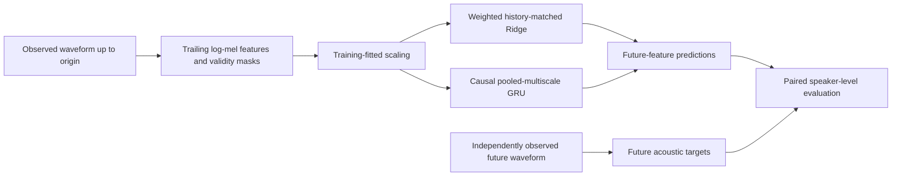

# RCLAT Temporal Prediction Engine (RTPE)

**Research overview, scientific results and engineering status**

**Evidence snapshot: 24 October 2026**

RTPE investigates whether the ordered evolution of continuous acoustic features supports useful prediction on previously unseen individuals. Its first completed experiment demonstrated a forecasting advantage for a causal GRU over a history-matched linear Ridge baseline on a speaker-disjoint human-speech development population.

The result concerns **future-acoustic prediction**. It does not establish transcription accuracy, semantic interpretation, behavioural prediction or animal transfer.

This document consolidates the repository evidence. It does not amend a frozen protocol or authorise a scientific restart. Frozen specifications, execution manifests and saved results remain authoritative.

## Latest engineering milestone: two-device optimisation checks

A separately frozen XPU-1 repetition passed **16/16 numerical and 288/288 fault cases**, matching the XPU-0 result. Maximum relative error was 4.82381e-7 against the fixed 1e-4 tolerance.

A second bounded diagnostic completed **20 consecutive AdamW updates for each of five original seeds on both XPUs**. All 200 paired update records passed. Original and corrected CPU paths remained bit-identical. Maximum relative errors included 6.02960e-7 for parameters, 1.28989e-6 for parameter gradients and 1.94383e-6 for input gradients; all recorded quantities, including optimizer moments and clipping norms, passed 1e-4.

These were 600 disposable engineering optimizer updates across the three reference/candidate models per sequence. Scientific optimizer updates remain zero. The check used fixed AdamW settings, original training fixtures and synthetic batch-128 inputs, without clearing caches between steps. It does not certify a full 5,000-update run or arbitrary execution histories. No scientific checkpoint was selected or reused, no evaluation scores were computed and production entrypoints remain unchanged. The five-seed scientific replication remains unevaluated.

See the [bounded execution closeout](../outputs/rclat_rtpe_guard_execution_v1/RESULTS.md) and [independent audit](../outputs/rclat_rtpe_guard_execution_v1/independent_audit.json). The next preparation milestone is a separately frozen scientific-successor specification; this engineering certificate does not itself launch it.

## Corrective five-seed scientific replication — completed

Following explicit user authorisation, RTPE-R1 v2 completed all **25,000 scientific updates**, 30 Ridge candidates and 100 validation/checkpoint events. Evaluation opened only after all five complete training schedules and validation selections were locked. The **all-five replication gate PASSED**.

| Seed | Selected update | GRU 80 ms MSE | Ridge-minus-GRU | Conditional 95% speaker interval |
|---|---:|---:|---:|---|
| 101 | 1750 | 0.593888 | 0.050823 | [0.035138, 0.068086] |
| 211 | 1250 | 0.597134 | 0.047577 | [0.035017, 0.061339] |
| 307 | 2000 | 0.600375 | 0.044336 | [0.028644, 0.061278] |
| 401 | 1250 | 0.603244 | 0.041468 | [0.027035, 0.057920] |
| 503 | 1500 | 0.597296 | 0.047415 | [0.032919, 0.062743] |

Shared Ridge MSE was 0.644712 with alpha 0.1; its saved forecasts were bit-identical across the five pipelines. Equal-seed mean improvement was **0.046324**, or **7.19%** of Ridge loss. Descriptive between-seed sample SD of the contrast was **0.003554**. Each seed's interval lower bound was strictly positive. Historical seed 17 was excluded from the gate.

The independent host audit verified 25,000 sequential sampler batches, 100 sampler RNG states, 130 checkpoint hashes, validation selections, forecast-score recomputation and future-target/cache bindings. Scientific execution took 529.5 seconds. No retries or scientific-policy adjustments occurred. See [scientific closeout](../outputs/rclat_rtpe_multiseed_v2_execution/SCIENTIFIC_RESULTS.md) and [independent audit](../outputs/rclat_rtpe_multiseed_v2_execution/scientific_closeout.json).

This strengthens finite-five-seed forecasting robustness on the same exposed development population. It is not independent source confirmation, a joint seed/speaker confidence claim, evidence of temporal-order causality, transcription or semantic recovery, animal transfer or behavioural utility. Original study outcomes remain unchanged. P100/P960 and MACDE–CAVEM Stage 2 remain blocked. Earlier unauthorised/unstarted statements below describe preserved preparation milestones, superseded for this successor by explicit authorisation and this completed execution.

## 1. Current status

| Component | Status |
|---|---|
| RTPE-ZS1 VCTK zero-shot transfer | **Completed; all-five primary criterion PASSED; precision disclosure retained** |
| VCTK waveform/feature support v2 | **Completed and independently audited; 43,873 recordings, 108 speakers, 12,514,518 eligible origins** |
| RTPE implementation and synthetic integration | Completed |
| Weighted estimators and numerical references | Verified under the tested conditions |
| RTPE-1 revision 2 | **Completed; primary development criterion passed** |
| Original five-seed attempt | Preflight failed; preserved as scientifically unevaluated |
| Corrective five-seed replication v2 | **Completed; all-five development replication criterion PASSED** |
| Instrumented XPU fault localisation | Completed; boolean-selection anomaly captured |
| Minimal operator-only reproducer | **Incomplete: 7 of 104 cases completed** |
| Stage-isolated operator diagnostic | Completed: 24 workers; six indexing discrepancies with verified inputs |
| Diagnostic predicate semantics | Passed the registered 132-worker validation matrix |
| Guard-only candidate integration | Passed 16 numerical and 288 fault cases; production entrypoints unchanged |
| Cross-device guard and optimiser check | Passed both XPUs; ten 20-update engineering sequences; production adoption pending |
| Corrective successor v2 execution | User-authorised; 25,000 updates and locked evaluation completed; independently audited |
| Linguistic and behavioural RTPE objectives | Inactive |
| P100/P960 and MACDE–CAVEM Stage 2 | Blocked |

The original positive RTPE-1 result remains closed. Subsequent numerical failures have not supplied a scientific replication result.

## 2. Research question and architecture

For a continuous acoustic sequence

\[
X=(x_1,\ldots,x_T),
\]

the engine constructs a causal state from observations available at the forecast origin and predicts independently observed future acoustic features.

The RTPE-1 question was:

> Does a causal pooled-multiscale GRU improve future-acoustic prediction over a weighted linear model receiving the same ordered history?

The GRU is unidirectional, with hidden dimension 64. Its inputs include causal masked moving means at scales of 1, 4 and 16 frames. A readout predicts 64 acoustic features at each registered horizon. These scales are modelling choices, not assumed phoneme, syllable or word boundaries.

Ridge receives the complete ordered history and validity indicators. Therefore, a GRU advantage demonstrates incremental utility beyond a linear ordered-history model; it does not establish that only the GRU uses temporal order.

The foundation also provides optional symbol readouts and a gated behavioural interface. Neither was used in RTPE-1. Independent references and separate protocols remain necessary for those tasks.

## 3. Data, validity and causal timing

### Population and sampling

RTPE-1 reused a previously exposed 10-hour subset of LibriSpeech `train-clean-100`, partitioned by source-labelled speaker identity.

| Partition | Speakers | Recordings | Hours | Eligible origins | Selected origins |
|---|---:|---:|---:|---:|---:|
| Training | 175 | 1,980 | 6.969 | 2,409,252 | 15,840 |
| Validation | 38 | 415 | 1.473 | 509,319 | 3,320 |
| Internal evaluation | 38 | 419 | 1.558 | 539,994 | 3,352 |
| **Total** | **251** | **2,814** | **10.000** | **3,458,565** | **22,512** |

Each recording contributes eight eligible origins, chosen by a frozen hash-ranking rule using identity and eligibility rather than target values or prediction errors. Both arms receive identical origins, histories, masks and targets.

Source/cache hashes, decoded PCM hashes, frame timing and mel regeneration were verified. Regenerated mel values matched the cache exactly. Speaker and parent-recording grouping checks were performed; source speaker identities were not independently re-adjudicated.

Evaluation speakers were excluded from RTPE fitting and validation selection. However, the corpus had already been exposed in earlier research. This is a **development evaluation**, not untouched independent confirmation.

### Timing contract

| Property | Specification |
|---|---|
| Audio sample rate | 16 kHz |
| Acoustic feature | 64-dimensional log-mel |
| Frame support | 640 samples / 40 ms |
| Frame hop | 160 samples / 10 ms |
| History | 32 frames, spanning 350 ms of waveform support |
| Forecast horizons | 40, 80 and 160 ms |
| Primary horizon | **80 ms** |

Frame \(j\) consumes the half-open waveform interval

\[
[160j,\;160j+640).
\]

Its declared availability is the exclusive end of that interval, rather than a nominal centre timestamp. For forecast origin \(t\), the primary target uses waveform support from \(t+40\) to \(t+80\) ms. Input and target waveform support do not overlap.

The frontend uses trailing windows and fixed spectral operations. A weighted scaler is fitted only on training inputs and then reused without evaluation adaptation. No full-recording normalisation is introduced at prediction time.

Entirely unsupported gaps exclude forecasting windows; time is not compressed across them. Partial feature missingness retains explicit validity masks. Unsupported target cells never become ordinary measured values.

## 4. Objective and frozen execution policy

### Population weighting

For speaker \(s\), recording \(r\) and selected origin \(i\), the origin weight is

\[
w_{sri}=\frac{1}{S\,R_s\,K_r},
\]

where \(S\) is the number of speakers, \(R_s\) the number of recordings for that speaker and \(K_r=8\) the selected origins per recording. Weights sum to one within each partition.

The training data objective is the weighted mean of each origin's mean squared error over observed target cells. Training supervises all three horizons; primary evaluation uses only 80 ms.

Ridge adds

\[
\frac{\alpha}{D}\sum_{d=1}^{D}\lVert\beta_d\rVert_2^2,
\]

with an unpenalised intercept and an explicit weight-normalisation convention. The tested alpha grid was `0.0001, 0.001, 0.01, 0.1, 1, 10`.

GRU minibatches sample origins uniformly with replacement. Their loss uses the population-weighted estimator \(N/B\sum_b w_{i_b}\ell_{i_b}\), rather than renormalising weights within the batch.

### GRU and selection policy

| Component | Frozen RTPE-1 policy |
|---|---|
| Initialisation seed | 17 |
| Optimiser | AdamW |
| Learning rate | 0.001 |
| Weight decay | 0.0001 |
| Batch size | 128 origins |
| Budget | **5,000 updates** |
| Gradient clipping | Norm 5 |
| Precision | FP32, no autocast |
| Validation/checkpoints | Every 250 updates |
| GRU selection | Minimum validation 80 ms loss; earliest exact tie |
| Ridge selection | Minimum validation 80 ms loss; earliest listed alpha on exact tie |
| Evaluation release | After all required fits/updates and locked validation-only selection |

All 5,000 updates must finish before selection is finalised. Intermediate success, final-checkpoint scores and secondary horizons cannot replace the primary endpoint.

The runtime requested oneDNN primitive-cache capacity 16,384. Numerical guards, resource bounds, source hashes, checkpoint/RNG provenance and failure records were retained. Automatic retries, resumption and outcome-driven policy changes were prohibited.

## 5. Completed RTPE-1 scientific result

### Primary endpoint

| Measurement | Weighted Ridge | Causal GRU |
|---|---:|---:|
| Speaker-macro 80 ms standardised MSE | 0.644712 | **0.596247** |
| Selected configuration | Alpha 0.1 | Update 1,750 |

The registered contrast was

\[
\Delta=L_{\mathrm{Ridge}}-L_{\mathrm{GRU}}.
\]

The observed result was

\[
\Delta=0.048465,\qquad
95\%\text{ paired speaker-bootstrap interval }[0.033495,\;0.064485].
\]

Both the point contrast and lower bound were strictly positive. **The registered development predictive-utility criterion passed.**

- Relative loss reduction: **7.52%**.
- Speakers with lower GRU loss: **30 of 38**.
- Final update-5,000 GRU loss: **0.612460**, descriptive only.

The interval used 10,000 paired whole-speaker bootstrap draws with the frozen seed. It conditions on the selected single-seed models and fixed origin sample. It does not include model-fitting, checkpoint-selection, origin-sampling or source-selection uncertainty.

### Execution audit

| Check | Verified outcome |
|---|---:|
| GRU updates | 5,000 / 5,000 |
| Ridge candidates | 6 / 6 |
| Validation/checkpoint events | 20 / 20 |
| Checkpoint hashes | 26 |
| Sampled batch sequences | 5,000 |
| Sampler RNG states | 20 |
| Evaluation recording/target bindings | 419 |
| Independent saved-forecast recomputation | Passed |
| Recorded runtime/numerical exceptions | None |

Execution took approximately 112.62 seconds, with peak logged host RSS of 3.593 GiB. These are observations for that run, not runtime guarantees.

**Supported conclusion:** the tested nonlinear causal model improved prospective acoustic-feature forecasting over a strong linear ordered-history comparator on the declared development population.

It does not establish an order-specific mechanism, transcription improvement, semantic understanding, communicative intent, animal transfer or behavioural utility. Earlier RCLAT and MACDE outcomes remain unchanged.

## 6. Five-seed replication and numerical fault localisation

### Replication specification and status

A separate development replication fixed five new initialization/sampler seed pairs:

| Initialisation seed | Sampler seed |
|---:|---:|
| 101 | 2026102311 |
| 211 | 2026102312 |
| 307 | 2026102313 |
| 401 | 2026102314 |
| 503 | 2026102315 |

The plan preserves the population, architecture, objectives, 5,000-update budget and validation-selection rules. All five models would train sequentially on XPU0, with all 25,000 updates and selections completed before any new evaluation score. The original seed 17 is historical evidence, not a new replicate.

The finite-five-seed consistency rule requires every seed to pass the original conditional criterion. Seed spread and speaker variation would be reported separately; no joint seed/speaker confidence interval is claimed.

**The replication did not start training.** Its XPU preflight raised `ValueError: Observed predictions and targets must be finite`. The original failure did not retain the failing seed/case. All 15 CPU fixture cases were subsequently finite. No scientific Ridge fit, GRU update or internal-evaluation score occurred, so the predictive criterion is **unevaluated**.

### Instrumented fault-localisation result

A separately frozen diagnostic recorded transfers, activations, loss operators and gradients for all 15 seed/case combinations.

| Mask support | Correct CPU selection | Instrumented XPU selection |
|---|---:|---:|
| Fully observed | 768 values | 512 values |
| One unsupported target cell | 767 values | 511 values |

Seeds 307/case 2 and 401/case 2 reproduced the exception. Source transfers, GRU states and forecast outputs were finite at observed cells. The first unexpected NaN appeared in `aten.index.Tensor` during `target[observed]` inside the validity guard.

All 15 instrumented cases had incorrect selection cardinality. Thirteen nevertheless met the original final loss/gradient parity criterion: the suspect gather fed a validity check, while the residual arithmetic used shape-preserving masking and reductions.

This localises the instrumented failures to an operator execution path. It does not identify the low-level kernel defect or retrospectively establish the original unlogged failing seed/case. Tracing also synchronises execution and may alter timing or dispatch.

### Minimal operator reproducer: incomplete

A subsequent diagnostic removed the GRU and dispatch tracing. It planned 104 cases covering captured tensors, alternative storage layouts, shape controls, deliberate NaN/Inf placement and two shape-preserving candidate checks.

Only **seven cases completed**. All seven reproduced incorrect native XPU selection cardinality. Both candidate boolean verdicts matched the reference for those completed, reference-valid cases, but two strided cases had incorrect observed counts. Three cases also had post-gather device-to-host input or mask comparisons that differed from the CPU source; without a pre-gather device snapshot, these differences cannot be assigned solely to indexing.

The eighth case, `target_full.masked_inf.strided`, did not complete. A watchdog stopped the diagnostic at its frozen 180-second limit. The precise stalled operation was not recorded.

**The full operator matrix and candidate guard validation remain incomplete. Neither candidate is certified, no production guard was changed, and no corrected replication was launched.**

### Fresh-process, stage-isolated diagnostic

A subsequent diagnostic separated six input/layout conditions into four operations: transfer only, boolean indexing, the AND-based predicate and the WHERE-based predicate. Each of the 24 workers ran in a fresh process with a 20-second limit, durable per-operation records and explicit synchronisation.

All 24 workers completed, with no timeouts. Transfers, backing allocations, layout copies and pre-operation roundtrips matched the CPU reference. Post-operation values and masks also remained equal to the source.

| Operation | Outcome |
|---|---|
| Transfer-only checks | 6/6 passed |
| Native boolean indexing | 6/6 returned incorrect cardinality |
| AND-based predicate | 6/6 matched the tested reference verdict and counts |
| WHERE-based predicate | 6/6 matched the tested reference verdict and counts |

The indexing outputs contained 512 instead of 768 elements for fully observed inputs, or 511 instead of 767 for partially observed inputs. Because inputs were verified before indexing and remained unchanged afterward, these cases isolate a selection discrepancy without an already incorrect input at the observed pre-index boundary.

The earlier masked-Inf strided stall and post-gather input discrepancies did not recur. This does not identify their cause: fresh processes, retained transfer buffers, synchronisation and observation all differ from the earlier execution history.

These were reference-valid localisation cases, not a full guard-certification matrix. At that stage, observed-invalid and empty-support cases still required device-level validation. Neither candidate was deployed, and the replication remained blocked.

### Registered guard-semantics matrix

A separately frozen matrix subsequently tested 11 semantic patterns, two FP32 target shapes—`(4, 3, 64)` and `(128, 3, 64)`—three layouts and two predicates. Each of its 132 workers ran in a fresh process with verified pre/post inputs and a 20-second limit.

Both diagnostic predicates passed all registered comparisons: **AND 66/66; WHERE 66/66**. Sixty workers correctly accepted reference-valid support and 72 correctly rejected observed-invalid or unsupported inputs. There were no timeouts.

The matrix verified observed NaN and positive/negative Inf rejection, masked nonfinite tolerance, empty-first-origin and entirely empty support rejection, sparse one-cell-per-origin acceptance, mixed observed-invalid/masked-nonfinite handling, and exact per-origin observed counts. The AND path's observed-nonfinite counts also matched an independent NumPy reference. CPU-only audit checked every decision, source/roundtrip snapshot and completed operation sequence.

This is a **scoped diagnostic certificate**, not production deployment. Scalar nonfinite probes used flattened position 0, with position 1 additionally used for the mixed masked-Inf condition; other fault locations were not exhausted. Fresh processes, retained transfer tensors and explicit synchronisation remain part of the tested conditions. That certificate alone did not certify model integration; the subsequent guard-only integration below provides separate evidence. No corrected replication was authorised or started.

## 7. Interpretation boundaries and next milestones

| Evidence level | Current conclusion |
|---|---|
| Software execution | Implemented and tested |
| Single-seed human-speech forecasting utility | Positive development result |
| Robustness across training seeds | Not established |
| Transfer to protected new sources | Not established |
| Unique contribution of temporal order | Not isolated |
| Linguistic or semantic decoding | Not established by RTPE |
| Independent behavioural prediction | Not established |
| Animal transfer | Not established |

A separately versioned WHERE-guard candidate subsequently passed all 16 CPU–XPU model/loss/gradient cases and all 288 fault cases, including first/middle/last fault positions, three layouts and batches 4 and 128. Original and candidate CPU results were bit-identical; maximum CPU–XPU relative error was 4.82381e-7 against the frozen 1e-4 tolerance. All 108 valid cases were accepted and all 180 invalid or unsupported cases rejected. The 78 CPU tests and lint passed. This verifies the bounded candidate integration on XPU 0; frozen production entrypoints remain unchanged. See [integration closeout](../outputs/rclat_rtpe_guard_integration_v1/RESULTS.md). The causes of the earlier stall and input discrepancies remain unresolved. A corrected replication requires its own prospective execution specification; the failed attempt must remain preserved.

After numerical prerequisites are satisfied, the fixed-seed replication can test robustness. Protected source-transfer, order-control, transcription and behavioural studies remain separate questions. **P100/P960 and MACDE–CAVEM Stage 2 remain blocked.**

## 8. Repository evidence and implementation

| Resource | Location |
|---|---|
| RTPE-1 frozen scientific specification | [protocol.json](../outputs/rclat_rtpe1_protocol_v2/protocol.json) |
| Dedicated execution manifest | [execution_manifest.json](../outputs/rclat_rtpe1_execution_v1/execution_manifest.json) |
| Scientific closeout | [SCIENTIFIC_RESULTS.md](../outputs/rclat_rtpe1_execution_v1/SCIENTIFIC_RESULTS.md) |
| Machine-readable scientific result | [result.json](../outputs/rclat_rtpe1_execution_v1/training/result.json) |
| Independent execution audit | [scientific_closeout.json](../outputs/rclat_rtpe1_execution_v1/scientific_closeout.json) |
| Verified sampled-origin inventory | [selected_origins.json](../outputs/rclat_rtpe_common_inventory_v1/selected_origins.json) |
| Five-seed replication failure status | [STATUS.md](../outputs/rclat_rtpe_multiseed_v1/STATUS.md) |
| Instrumented fault-localisation report | [RESULTS.md](../outputs/rclat_rtpe_numerical_trace_v1/RESULTS.md) |
| Incomplete minimal-operator diagnostic | [STATUS.md](../outputs/rclat_mask_operator_v1/STATUS.md) |
| Stage-isolated operator diagnostic | [RESULTS.md](../outputs/rclat_mask_stages_v1/RESULTS.md) |
| Guard-semantics validation report | [RESULTS.md](../outputs/rclat_guard_validation_v1/RESULTS.md) |
| Scoped diagnostic predicate certificate | [certificate.json](../outputs/rclat_guard_validation_v1/certificate.json) |
| Causal pooled-multiscale engine | [rclat_rtpe_pool.py](../src/bioacoustic_pipeline/representation/rclat_rtpe_pool.py) |
| Weighted estimators and losses | [rclat_rtpe_weighted.py](../src/bioacoustic_pipeline/representation/rclat_rtpe_weighted.py) |
| Scientific runner | [rclat_rtpe_train.py](../scripts/rclat_rtpe_train.py) |
| Implementation contracts | [RCLAT_RTPE_DEVELOPMENT.md](RCLAT_RTPE_DEVELOPMENT.md) |
| Weighted-estimator conventions | [RCLAT_RTPE_WEIGHTED_ESTIMATORS.md](RCLAT_RTPE_WEIGHTED_ESTIMATORS.md) |
| Runner operation and safeguards | [RCLAT_RTPE_EXECUTION.md](RCLAT_RTPE_EXECUTION.md) |

### Research-ledger statement

> RTPE-1 revision 2 completed its frozen weighted Ridge-versus-causal-GRU comparison and passed the primary development predictive-utility criterion. At 80 ms, speaker-macro standardised MSE was 0.644712 for Ridge and 0.596247 for the selected GRU, a difference of 0.048465 with conditional speaker-bootstrap interval [0.033495, 0.064485]. Subsequent five-seed robustness remains untested because numerical preflight failed before training. Separate diagnostics captured an XPU boolean-selection anomaly. Staged diagnostic predicates passed a registered 132-worker semantics matrix, and a separate guard-only candidate passed its bounded model/loss/gradient integration matrix. Production adoption and replication restart have not occurred. The positive single-seed result, numerical limitations and broader progression blocks remain distinct.

## Corrective successor specification v2

The [new specification](../outputs/rclat_rtpe_multiseed_v2_spec/protocol.json) preserves every predecessor scientific field except study/status/freeze metadata and adds only the certified WHERE-guard substitution. The five seed pairs, 25,000-update total, Ridge comparator, XPU-0 sequential assignment, global evaluation seal and decision rules are unchanged. Its [preparation manifest](../outputs/rclat_rtpe_multiseed_v2_spec/preparation_manifest.json) is explicitly not an execution manifest. A dedicated corrected runner, verification and separate execution binding remain pending. No scientific execution was authorised or started. Two added TDD tests check scientific-field preservation and incomplete-specification rejection.

## Corrected runner preparation completed

The separately versioned [corrected runner](../scripts/rclat_rtpe_replication_corrected.py) and [staging module](../src/bioacoustic_pipeline/diagnostics/rclat_rtpe_replication_corrected.py) are implemented. The [execution manifest](../outputs/rclat_rtpe_multiseed_v2_execution/execution_manifest.json) binds them to the unchanged frozen specification. All 87 CPU tests, lint, 2,814 source/cache checks and 15 XPU-0 preflight cases passed. Maximum preflight relative error was 4.82381e-7. The [preparation closeout](../outputs/rclat_rtpe_multiseed_v2_execution/RESULTS.md) records the independent artifact audit. Earlier runner-pending statements describe the prior milestone.

No scientific authorisation record was created and no scientific training or scoring started. The execute action requires explicit authorisation bound to both frozen hashes. All five 5,000-update runs and selections must complete before evaluation access; the original failed attempt remains preserved and predictive robustness remains unevaluated.

## Independent-source support audit

A bounded metadata-only [local support audit](../outputs/rclat_rtpe_transfer_support_v1/RESULTS.md) abstained from certifying an independent source corpus. The inspected receipts and speaker metadata identify LibriSpeech; distinct official partitions remain the same source corpus, and several have documented development exposure. This is a provenance limitation, not a negative forecasting result. No audio, checkpoints or predictions were opened and no new fitting/scoring occurred. The next protocol must identify an independently documented external source and distinguish zero-shot transfer from new-source retraining before certifying source support or accessing evaluation outcomes.

## External-source candidate discovery

Official Edinburgh documentation identifies VCTK 0.92 as a candidate separately collected speech corpus. The [discovery note](../outputs/rclat_rtpe_external_source_discovery_v1/README.md) records provenance, publisher-listed licence/checksum, known microphone limitations, the bounded local exposure search and a draft strict zero-shot design. It does not certify data support or historical non-exposure. No audio was acquired or scored. A new source-support audit and causal resampling check are required before a scientific transfer protocol can be frozen.

## VCTK pre-acquisition and synthetic timing audit

The [support-audit plan](../outputs/rclat_rtpe_vctk_preacquisition_v1/plan.json) was frozen before audio acquisition. Official README/licence text files matched publisher checksums. The [closeout](../outputs/rclat_rtpe_vctk_preacquisition_v1/RESULTS.md) records a TDD causal 48-to-16 kHz FIR candidate; 90 CPU tests and lint passed. Its source-support accounting reveals overlap at the 40 ms target, while 80 ms and 160 ms remain disjoint. No complete three-horizon certificate is issued. Initial resampler support, channel mapping, valid-history eligibility and filter suitability must be handled before a transfer protocol is frozen. No VCTK audio was acquired, processed or scored. The candidate is not integrated into the frozen frontend, and all completed scientific results remain unchanged.

## VCTK horizon and timing-eligibility policy frozen

[Option A](../outputs/rclat_rtpe_vctk_horizon_policy_v1/RESULTS.md) is locally frozen: 80 ms primary, 160 ms secondary, 40 ms unscored, with all five existing models/scalers/Ridge states hash-bound and unchanged. Timing-only eligibility excludes FIR startup padding and requires origin >=32 with both retained targets present. The combined suite passed 93 CPU tests; lint passed. This policy does not certify channel mapping, filter suitability, actual corpus support or a complete scientific evaluation protocol. No VCTK audio was acquired or model inference performed.

## VCTK filter adequacy and microphone documentation audit

The [frozen audit](../outputs/rclat_rtpe_vctk_filter_mic_audit_v1/RESULTS.md) found the unchanged 97-tap filter passes its <=0.1 dB 0–6 kHz deviation requirement (0.01444 dB) but fails the prospectively chosen >=60 dB 8–24 kHz suppression requirement (28.35782 dB on the response grid;28.35498 dB at exactly8 kHz). Independent complex-DFT and synthetic-tone checks agreed. No filter retuning occurred. The focused suite passed95 CPU tests;lint passed. These are audit-specific engineering requirements,not a universal quality standard.

Official TensorFlow Datasets documentation explicitly maps mic2 to Sennheiser MKH800;the policy prospectively selects mic2 only with no fallback. Actual archive mapping and eligibility remain unverified. No VCTK audio was acquired or scored. A separately specified corrective filter must re-establish retained-horizon support before scientific transfer preparation proceeds. Original RTPE results remain unchanged.

## VCTK corrective resampler v2 — bounded engineering PASS

A separately frozen193-tap,7kHz-cutoff causal FIR passed the unchanged <=0.1dB passband and >=60dB stopband requirements: observed maximum deviation0.000343dB and worst grid suppression89.20597dB. Independent DFT,tone,prefix and synthetic frontend checks passed. The first64decimatedsamples are unsupported;the firstmel frame is masked. Renewed source gaps are1,730samples(36.0417ms) for80ms and5,570samples(116.0417ms) for160ms. The40ms output remains excluded. All15bound GRU/Ridge/scaler files are unchanged. The focused suite passed97CPUtests and lint.

See [corrective closeout](../outputs/rclat_rtpe_vctk_filter_correction_v2/RESULTS.md). This verifies synthetic arithmetic,format and support;it does not certify real VCTK eligibility,feature distribution compatibility or transfer. The failed97tap candidate and earlier policy are preserved;any transfer specification must explicitly bind v2rather than silently replace its preprocessing dependency. No VCTK audio was acquired or model inference performed.

## VCTK acquisition/support policy v1

The [versioned policy](../outputs/rclat_rtpe_vctk_acquisition_protocol_v1/README.md) explicitly binds FIR v2,its coefficients/startupmask and renewed80/160ms support gaps,mic2-only/no-fallback,event grouping,source checksums and archive-safety rules. A point-in-time80GiB-headroom preflight passed. The focused suite passed99CPUtests;lint passed. The preparation script performs no download,extraction,decoding or inference. A separately pinned acquisition/support runner remains pending;actualsourceeligibility and a fulltransferprotocol are not certified.

## VCTK source-only runner readiness

The [acquisition/support runner](../scripts/rclat_rtpe_vctk_support_runner.py) is implemented and separately pinned. Its [synthetic verification closeout](../outputs/rclat_rtpe_vctk_support_verification_v1/RESULTS.md) records107passing CPUtests,lint,exactFIRcoefficients,reproducible support records,checksum/failure preservation,mic2/event grouping and duplicate handling. Six synthetic events yielded two retained recordings from two synthetic speakers and98eligible origins. No actual VCTK counts are implied. The official-source resolver was tested with mockedAPIresponses;live resolution remains pending.

No source authorisation record has been created and no VCTK archive downloaded or realaudio decoded. The runner has noforecasting/training action;acquisition andsupportauditing require hash-bound source-only authorisation. Protectedoriginselection,scientificuncertainty and transfercriteria remain unfrozen. All completed RTPEscientific artifacts anddropout dependencies were verified unchanged.

## VCTK live metadata resolution — PASS

The pinned runner successfully resolved the live official archive metadata without downloading audio. [Resolution closeout](../outputs/rclat_rtpe_vctk_support_execution_v1/LIVE_RESOLUTION.md) records the exact archive size11,747,302,977bytes(10.9405GiB),matching publishedMD5 and officialcontentURL. Dependencies remain unchanged. Earlier mocked-only resolver notes describe the prior milestone. No source-authorisation record,archive acquisition,waveform audit or model inference exists;acquisition and support auditing still require distinct authorisations.

## VCTK archive acquisition — independently verified

Following explicit acquisition-only user approval,the official archive was downloaded once without retry/resume. The [acquisition closeout](../outputs/rclat_rtpe_vctk_support_execution_v1/ACQUISITION_RESULTS.md) verifies11,747,302,977bytes(10.9405GiB),publisherMD5 `8a6ba2946b36fcbef0212cad601f4bfa` and independently recomputedSHA256 `f96258be9fdc2cbff6559541aae7ea4f59df3fcaf5cf963aae5ca647357e359c`. No partial file remains. The complete archive has not been opened for member inspection or waveform decoding. Source-support auditing remains separately unauthorised,and scientific transfer remains unevaluated. Earlier no-acquisition statements describe preserved prior milestones.

## First real-source support attempt — incomplete

The source-only support audit was user-authorised and executed once. It stopped in metadata validation before any waveform decoding because the frozen parser accepted only p-prefixed IDs,whereas the official archive includes rostered speaker s5. A [metadata-only diagnostic](../outputs/rclat_rtpe_vctk_identifier_diagnostic_v1/RESULTS.md) localised all796rejected names to s5. The archive contains88,328FLACmembers(44,455mic1/43,873mic2) across110speaker directories;these are metadata counts,not retained acoustic-support counts. No source feature or forecasting computation occurred.

The failed attempt,original parser and manifests are preserved without retry. A separately versioned roster-aware correction is required before another support attempt. Original acquisition-only authorisation bytes were retained as a snapshot when source-audit approval extended the mutable control record. Real-source eligibility and scientific transfer remain unknown.

## Roster-backed support successor v2 — ready,not authorised

A new strict source contract,ingestion module and [corrected runner](../scripts/rclat_rtpe_vctk_support_corrected.py) are separately pinned. The [readiness report](../outputs/rclat_rtpe_vctk_support_execution_v2/RESULTS.md) records120passing CPUtests,lint,roster membership/s5regressions and syntax-tree verification of unchanged waveform/support/duplicate calculations. The real metadata pass recognised all88,328FLACmembers and796previously rejected s5files without decoding waveforms. A synthetic p/s5 integration reproduced98eligible origins and identical records twice.

The original failed attempt and frozen policies are preserved. No successor source-authorisation record exists and no corrected real-audio audit has run. Actualwaveformeligibility and scientifictransfer remain unknown. A fresh hash-bound source-only approval is required before the new audit action.

## VCTK real-source support v2 — completed and verified

Following fresh hash-bound user authorisation,the roster-backed source-only audit completed all44,455recording events. It retained **43,873unique mic2recordings from108rostered speakers**,with **12,514,518eligible forecasting origins**. The582excluded events lack mic2;there was no mic1fallback. No exact decoded-PCM duplicate groups were found. Allretained waveforms were finite mono48kHz and passed the certifiedFIR-v2/frontend/history/80-and160ms support checks. Rostered speaker s5 contributes398recordings and148,709eligible origins. The original failed v1attempt remains preserved.

The [independent closeout](../outputs/rclat_rtpe_vctk_support_execution_v2/SUPPORT_RESULTS.md) verified44,455source rows,43,873timing-origin arrays/hashes,duplicate assignments and per-speaker totals against saved records. Eligibleorigins per retained recording range70–1,604,median261. Source CRC/hash and acquisition receipts are retained. CPU launch context is recorded in source_runtime_context.json. Counts certify bounded empirical source support,not globally verified cross-corpus human identity or a protected evaluation inventory.

No forecasting model/scaler was fitted,selected or invoked,and no predictive loss was computed. Scientific sampling,minimumsupportdecision,uncertainty and zero-shot transfer gate remain unfrozen. The next milestone is a prospective,bounded protected-origin and all-five inference specification. RTPE-1/R1positive findings and P100/P960/MACDE–CAVEM blocks remain unchanged. Earlier pending/unauthorised statements are preserved preparation history,superseded for this support-only stage by explicit authorisation and this completed audit.

## RTPE-ZS1 VCTK zero-shot specification and protected sample — frozen

The [new specification](../outputs/rclat_rtpe_vctk_transfer_protocol_v1/README.md) prospectively selects all108supported speakers,32recordings per speaker and8origins per recording:**3,456recordings/27,648origins**. A canonicalSHA256salt ranksrecordings andvalidity-derivedorigins without waveform,feature or predictive-array access. All108speakers satisfy thefixedsupportrequirement;none was dropped. The [independent sampling audit](../outputs/rclat_rtpe_vctk_transfer_protocol_v1/independent_sampling_audit.json) reproduced everyselectedevent/origin andweight. The focused suite passed122CPUtests;lint passed.

Allfiveexisting model/Ridge/scaler sets are hash-bound withoutadaptation.80ms isprimary,160msdescriptive and40msunscored. Each model receives a fixed10,000drawpairedspeaker95%percentile interval;theall-fivecriterion requires allprimarypoints andlowerbounds strictlypositive. Aggregate seedmean/spread remain descriptive. A dedicated inference runner,separateexecutionmanifest,numerical/source/stateverification andexplicit scientific authorisation remain pending. No scientific inference or predictive scoring occurred. ExistingpositiveRTPEfindings anddownstreamblocks remain unchanged.

## RTPE-ZS1 inference-only execution readiness — passed

The [dedicated runner](../scripts/rclat_rtpe_vctk_zero_shot.py) andexecutionmanifest are pinned. Its [readiness closeout](../outputs/rclat_rtpe_vctk_zero_shot_execution_v1/RESULTS.md) records130passingCPUtests,lint,exactselectedsource/PCM/feature/mask/originregeneration for3,456recordings/27,648origins,andidenticalfrozenRidge/scalerstates acrossallfivefamilies. All15selected-checkpointCPU–XPUcomparisons passed on originalLibriSpeechtrainingfixtures;maximumrelativeerror1.34869e-6against1e-4. An independenthostaudit rechecked savedtensors/cacheIDs/masks andsyntheticfive-model lock/scoring/bootstrapbehaviour.

No VCTKmodelpredictions,predictivelosses,modeladaptation oroptimiserupdates occurred. Scientificexecute requires explicit authorisation bound to protocol,executionmanifest,sourceverification andpreflighthashes. No suchrecord orscientificrunmarker exists. Immutableprotocol runner-pending fields describe itsoriginalfreeze;the newexecutionpackage records readiness without changing it. Scientifictransfer remains UNEVALUATED;earlierpositiveRTPEfindings anddownstreamblocks remain unchanged.

## RTPE-ZS1 VCTK zero-shot evaluation — completed;all-five PASS

Following explicit hash-bound user authorisation,the frozen inference-only evaluation completed on108speakers,3,456recordings and27,648protected origins. Allfiveprediction sets were persisted andhash-locked before scoring. Every80msRidge-minus-GRUcontrast andconditional95%speaker-bootstrap lower bound waspositive;theall-five criterionPASSED. No adaptation,refitting,retuning,selection,replacement orretry occurred. Scientificexecution took30.6seconds.

| Seed | Ridge MSE | GRU MSE | Difference | Conditional95% interval |
|---|---:|---:|---:|---|
| 101 | 0.772650 | 0.722798 | 0.049852 | [0.042937,0.056890] |
| 211 | 0.772650 | 0.764151 | 0.008499 | [0.001999,0.014888] |
| 307 | 0.772650 | 0.743609 | 0.029042 | [0.022007,0.035852] |
| 401 | 0.772650 | 0.759919 | 0.012731 | [0.006337,0.019129] |
| 503 | 0.772650 | 0.740113 | 0.032537 | [0.024965,0.040170] |

Mean primary contrast:0.026532,relativeRidge loss reduction:3.43%;descriptive between-seedSD:0.016597. See [scientific report](../outputs/rclat_rtpe_vctk_zero_shot_execution_v1/SCIENTIFIC_RESULTS.md),[independent audit](../outputs/rclat_rtpe_vctk_zero_shot_execution_v1/independent_scientific_closeout.json) and[final artifact seal](../outputs/rclat_rtpe_vctk_zero_shot_execution_v1/final_scientific_artifact_manifest.json).

**Precision correction:**the preparation report overstated residual precision.The frozen NumPy scorer usesFP32subtraction followed byFP64square/reduction. A first pureFP64host comparison caught a2.2e-11point discrepancy;the original audit and discrepancy record arepreserved.A separately versioned host audit exactlyreproduced thecanonical scoring and independently compared a pureFP64reference.Allprimaryandsecondarydecisions agreed;maximuminterval-bound difference was3.3e-10.No scientificvalues orpredictions were changed orrerun.See the [explicit correction](../outputs/rclat_rtpe_vctk_zero_shot_execution_v1/SCORING_PRECISION_CORRECTION.md).The authoritative finalseal was generated after the host-audit console closed;the provisional manifest is retained with an explicit sealing record.

This supports fixed-five-model,zero-shot external-source acousticforecasting on the protectedVCTKmic2sample.It doesnot establish temporal-ordercausality,linguistic/semanticrecovery,animaltransfer,behaviouralutility or globally distinct humanidentities. Per-seedintervals condition on selectedmodels andsample;seed aggregates aredescriptive. OriginalRTPE-1/R1results andP100/P960/MACDE–CAVEM blocks remainunchanged.Earlier unauthorised/unstarted statements arepreserved historicalpreparationmilestones.

## Portable RTPE-ZS1 review evidence

A [documents-only ZIP](../outputs/rclat_rtpe_vctk_review_bundle_v1/RTPE-ZS1_documents.zip) supplies theprimary scientific report,audit JSON andregistered result. The [full review ZIP](../outputs/rclat_rtpe_vctk_review_bundle_v1/RTPE-ZS1_full_review.zip) supplies all110originalfinal-manifest artifacts plusprotocol,inventory,model states,code andlicence notices. The standalone NumPy verifier checked178bundlepayloads,all110scientific references,andrecomputed allfiveprimary/secondary losses,bootstrapintervals andtheall-fivePASS withoutmodelinference. See [review guide](../outputs/rclat_rtpe_vctk_review_bundle_v1/REVIEW_GUIDE.md). These are locally verified review materials,not a claim of independent third-party execution. Original scientific artifacts remain unchanged.
